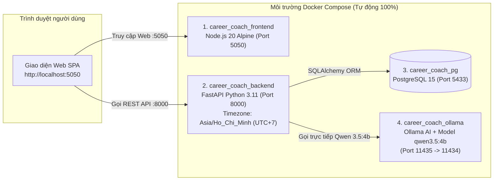

# AI Career Coach: Trợ lý định hướng nghề nghiệp và luyện phỏng vấn thông minh

[](./LICENSE)
[](./docker-compose.yml)
[](https://ollama.com/)

---

## 1. Giới thiệu tổng quan

**AI Career Coach: Trợ lý định hướng nghề nghiệp và luyện phỏng vấn thông minh** giải quyết bài toán định hướng nghề nghiệp và huấn luyện kỹ năng cho sinh viên / người đi làm ở mọi lĩnh vực thông qua quy trình khép kín 4 bước:
1. **Đánh giá năng lực hiện tại (Song ngữ Anh – Việt, Đa ngành nghề & Chống file rác)**: Trích xuất tự động kỹ năng chuyên môn, kỹ năng mềm và kinh nghiệm từ file CV PDF tải lên (chỉ chấp nhận `.pdf`, tự động phát hiện và chặn file rác không phải CV) hoặc chọn bộ hồ sơ mẫu đa lĩnh vực. Tự động nhận diện ngôn ngữ của CV (**CV Tiếng Anh trả về 100% kỹ năng Tiếng Anh, CV Tiếng Việt trả về 100% kỹ năng Tiếng Việt**) trên **15+ nhóm ngành lớn** (*CNTT/Phần mềm, Dữ liệu/BA, Tài chính/Kế toán/Kiểm toán, Luật/Pháp chế, F&B/Nhà hàng - Khách sạn, Marketing/Truyền thông, Nhân sự/HR, Kinh doanh/Sales, Logistics/Chuỗi cung ứng, Kỹ thuật/Sản xuất, Y dược, Giáo dục, Thiết kế/Sáng tạo*).
2. **Phân tích Độ khớp & Kết luận Chuyên sâu (Universal Skill-Gap & JD Analysis)**: So khớp hồ sơ (hỗ trợ đối chiếu chéo song ngữ Anh – Việt và chống khớp nhầm từ khóa ngắn) với vị trí mẫu hoặc **Mô tả công việc (JD) dán tự do của bất kỳ ngành nào**. Chấm điểm theo công thức trọng số, vẽ biểu đồ Radar năng lực theo nhóm ngành, lưu lịch sử phân tích vào PostgreSQL và đưa ra **Báo cáo Kết luận & Đánh giá chuyên sâu** đa chiều.
3. **Lên lộ trình học tập Cá nhân hóa & Băm giờ thông minh (Smart Study Planner - Múi giờ `UTC+7`)**: Thiết kế các bài học nhúng đích danh từng kỹ năng còn thiếu, tự động cắt nhỏ thời lượng bài học để lấp vừa khít các khung giờ rảnh thực tế của người học và mở khóa đúng giờ (`unlock_time` theo chuẩn giờ Việt Nam `Asia/Ho_Chi_Minh`). Hỗ trợ cập nhật lại lịch rảnh mà vẫn giữ nguyên lộ trình và tiến độ đang học.
4. **Luyện phỏng vấn Ngẫu nhiên Đa vòng & Chấm điểm STAR + Gamification**: Giả lập phòng phỏng vấn với 4 vòng (*Vòng Nhân sự HR, Vòng Chuyên môn Tech Lead, Vòng Văn hóa Culture Fit, Vòng Cuối Hiring Manager*) bằng **Tiếng Việt hoặc Tiếng Anh**. Mỗi lượt đều **sinh ngẫu nhiên bộ 3 câu hỏi mới không trùng lặp** với cách xưng hô chuẩn mực (*Tôi - bạn*), chấm điểm chi tiết (thang `1.0 – 10.0`), viết lại đáp án mẫu chuẩn **STAR**, lưu trữ vào Database và thưởng điểm **XP** để nuôi trồng **Mầm cây tri thức** qua 6 giai đoạn.

---

## 2. Các tính năng cốt lõi của hệ thống

| Phân hệ | Chi tiết tính năng |
| :--- | :--- |
| **1. Quản lý Tài khoản Bảo mật & Trích xuất CV Song ngữ (VI / EN)** | • Đăng ký / Đăng nhập tài khoản cá nhân: Kiểm tra chặt chẽ định dạng Email, độ dài & độ mạnh mật khẩu, **băm mật khẩu một chiều bằng thuật toán `SHA-256`** trước khi lưu vào Database.<br>• Tách biệt hoàn toàn ID hồ sơ mẫu (`9991`, `9992`, `9993`) với chuỗi ID tự tăng của người dùng thật để không bao giờ xảy ra xung đột khóa chính (`Primary Key`).<br>• Tách biệt hoàn toàn phiên làm việc giữa các tài khoản: Khi đăng xuất hoặc chuyển đổi tài khoản, hệ thống tự động xóa sạch các khóa bộ nhớ gắn theo ID (`analysis_done_${id}`, `analysis_data_${id}`, `has_analyzed_${id}`) và làm mới lộ trình trên giao diện.<br>• **Đồng bộ ngôn ngữ CV 2 chiều**: Tải CV Tiếng Anh trả về 100% kỹ năng/kỹ năng mềm bằng Tiếng Anh; tải CV Tiếng Việt trả về 100% bằng Tiếng Việt (giữ nguyên tên công nghệ/chứng chỉ quốc tế như Python, Laravel, Excel, MISA, HACCP). |
| **2. Phân tích JD Tự Do Mọi Ngành & Đối sánh Chính xác** | • Hỗ trợ chọn JD mẫu đa ngành hoặc **dán trực tiếp bất kỳ JD thực tế nào vào ô JD Tự do** (giới hạn an toàn `maxlength="5000"`).<br>• Chống khớp nhầm từ khóa ngắn (`"C"`, `"Git"`, `"AI"`, `"Java"`) vào các từ dài (`"Excel"`, `"Digital"`, `"Email"`, `"JavaScript"`).<br>• Công thức chấm điểm định lượng: **50% Kỹ năng chuyên môn + 25% Mức độ hứng thú + 25% Kinh nghiệm thực tế**.<br>• Tự động lưu trữ toàn bộ thông tin vào 7 bảng Database (`profiles`, `jobs`, `analyses`, `study_tasks`, `streaks_and_reports`, `feedbacks`, `interviews`). |
| **3. Lộ trình Học tập Nhúng Đích Danh Kỹ Năng & Cập nhật Lịch rảnh** | • Tự động sinh danh sách bài học thực chiến **nhúng đích danh tên kỹ năng cần học vào tiêu đề bài học**.<br>• **Cập nhật lịch rảnh giữ nguyên lộ trình (`/study-plan/update-schedule`)**: Đổi khung giờ rảnh và tự động phân bổ lại các bài học chưa hoàn thành mà không làm mất lộ trình, không mất bài đã học hay chuỗi Streak.<br>• Xử lý chính xác giá trị phút `00` / giờ `00` và đồng bộ thời gian thực trên Dropdown chọn giờ học ngày hôm nay (`isToday`). |
| **4. Phỏng vấn Ngẫu nhiên Đa vòng (VI / EN) & Chấm điểm STAR** | • **Hỗ trợ 2 ngôn ngữ Tiếng Việt & Tiếng Anh**: Xưng hô chuẩn mực doanh nghiệp (*Tôi - bạn*), đóng vai giám khảo hỏi trực tiếp tự nhiên, không lặp lại góc độ câu hỏi.<br>• **Giao diện phòng thi thực chiến**: Ẩn gợi ý STAR trước khi nộp bài; chỉ hiển thị điểm số, nhận xét chi tiết và đáp án mẫu chuẩn STAR sau khi ứng viên nộp câu trả lời (`maxlength="2000"`).<br>• Ép kiểu đầu ra `format='json'` cho toàn bộ các lời gọi `ollama.chat()` và ghi nhật ký AI chi tiết (`[AI MODEL CALL]`, `[AI CV EXTRACT]`, `[AI JD EXTRACT]`, `[AI SKILL MATCH]`, `[AI STUDY PLAN]`, `[AI INTERVIEW GENERATE]`, `[AI INTERVIEW EVALUATE]`). |
| **5. Gamification & Thẻ Nghỉ Phép Thông Minh** | • **Quá trình nuôi cây gắn liền với lộ trình**: Tổng XP mục tiêu = `(Tổng số bài học × 50 XP) + (Số ngày của lộ trình × 25 XP tưới cây)` qua 6 giai đoạn phát triển (hỗ trợ nhảy nhiều cấp liên tiếp khi nhận lượng lớn XP).<br>• **Thẻ Phiếu Nghỉ Phép (1 lần / 1 tuần)**: Chỉ cho phép sử dụng vào ngày có lịch học và khi chưa hoàn thành bài học trong ngày; nếu đã xin nghỉ phép nhưng đổi ý vào hoàn thành bài học hôm đó, hệ thống **tự động hoàn trả lại thẻ nghỉ phép (`1/1`)** và mở khóa lại các bài học còn lại trong ngày (`excused` -> `active`). |

---

## 3. Kiến trúc hệ thống (4 Containers tự động hoàn toàn)



---

## 4. Hướng dẫn Biên dịch và Cài đặt (Compilation & Installation)

*(Xem thêm tài liệu chi tiết tại [docs/INSTALL.md](./docs/INSTALL.md)).*

### Yêu cầu trước khi cài đặt
* Máy tính đã cài đặt và bật sẵn **[Docker Desktop](https://www.docker.com/products/docker-desktop/)** (đảm bảo Docker Engine đang ở trạng thái **Running**).
* **Không cần** cài đặt Python, Node.js, PostgreSQL hay Ollama bên ngoài máy thật.

### Bước 1: Tải mã nguồn từ Git về máy
```bash
git clone https://github.com/tql-team/ai-career-coach.git
cd ai-career-coach
```

### Bước 2: Biên dịch Docker Image và Khởi chạy toàn bộ hệ thống
Bạn có thể chạy bằng **Docker Compose** hoặc bằng **GNU Make (`Makefile`)**:

```bash
# Cách 1: Sử dụng Docker Compose trực tiếp
docker compose up --build -d

# Cách 2: Sử dụng GNU Make (Makefile)
make install
```

*(Tùy chọn) Biên dịch riêng từng `Dockerfile`:*
```bash
# Biên dịch image cho Backend FastAPI
docker build -t ai-career-coach-backend:latest ./back_end

# Biên dịch image cho Frontend Node.js
docker build -t ai-career-coach-frontend:latest ./front_end
```

### Bước 3: Mở trình duyệt và sử dụng hệ thống

| Thành phần | Đường dẫn truy cập | Mô tả chi tiết |
| :--- | :--- | :--- |
| **Giao diện Web chính (Frontend)** | **[http://localhost:5050](http://localhost:5050)** | Giao diện sử dụng đầy đủ các tính năng của ứng dụng |
| **Tài liệu API (Swagger UI)** | **[http://localhost:8000/docs](http://localhost:8000/docs)** | Giao diện kiểm thử trực tiếp toàn bộ 20 REST API của Backend |
| **Kiểm tra trạng thái Backend** | **[http://localhost:8000/](http://localhost:8000/)** | Trả về thông điệp JSON xác nhận server đang hoạt động |
| **PostgreSQL Database** | `localhost:5433` | **User**: `admin` \| **Pass**: `secretpassword123` \| **DB**: `career_coach` |
| **Ollama AI Container** | `localhost:11435` | Cổng AI của Docker (ánh xạ ra cổng `11435` để không đụng cổng `11434` trên máy host) |

---

## 5. Hướng dẫn Kiểm tra Model AI (`qwen3.5:4b`) đã tải về và đang chạy chưa

```bash
# 1. Kiểm tra danh sách các model AI đã được tải về thành công trong Docker
docker exec -it career_coach_ollama ollama list
# Hoặc dùng GNU Make:
make check-model

# 2. Kiểm tra xem model AI có đang được nạp và chạy trong RAM/VRAM hay không
docker exec -it career_coach_ollama ollama ps

# 3. Nếu mạng bị gián đoạn khiến model chưa tải xong, chạy lệnh sau để tải trực tiếp kèm thanh %:
docker exec -it career_coach_ollama ollama pull qwen3.5:4b
```

Kiểm tra qua HTTP API:
* **Trên Windows PowerShell**: `Invoke-RestMethod -Uri "http://localhost:11435/api/tags"`
* **Trên CMD / Linux / macOS**: `curl http://localhost:11435/api/tags`

---

## 6. Hướng dẫn Kiểm tra Log Hệ thống & Log Model AI (Check Logs)

Toàn bộ các chức năng gọi Model AI (`qwen3.5:4b`) đều in log trực tiếp kèm nhãn nhận diện rõ ràng (`[AI MODEL CALL]`, `[AI CV EXTRACT]`, `[AI JD EXTRACT]`, `[AI JD ADVANCED EXTRACT]`, `[AI SKILL MATCH]`, `[AI STUDY PLAN]`, `[AI INTERVIEW GENERATE]`, `[AI INTERVIEW EVALUATE]`):

```bash
# 1. Kiểm tra trạng thái hoạt động (Running / Healthy) của cả 4 containers
docker compose ps

# 2. Xem log trực tiếp của Backend FastAPI & toàn bộ kết quả Model AI (Khuyến nghị khi chấm bài)
docker compose logs -f backend
# Hoặc dùng GNU Make:
make logs

# 3. Xem log riêng của AI Server Ollama (tiến độ tải model qwen3.5:4b)
docker compose logs -f ollama

# 4. Xem log riêng của Frontend Web Server (Node.js cổng 5050)
docker compose logs -f frontend

# 5. Xem log riêng của Cơ sở dữ liệu PostgreSQL
docker compose logs -f postgres_db

# 6. Chỉ xem 100 dòng log gần nhất của Backend mà không treo terminal
docker compose logs --tail=100 backend
```

---

## 7. Hướng dẫn Gỡ cài đặt & Dọn dẹp hệ thống (Uninstallation)

### Bước 1: Dừng và gỡ Container (Giữ lại dữ liệu Database và Model AI đã tải)
```bash
docker compose down
# Hoặc: make down
```

### Bước 2: Gỡ cài đặt Container + Xóa sạch dữ liệu Database & Volume (Reset dữ liệu về mới tinh)
```bash
docker compose down -v
```

### Bước 3: Gỡ cài đặt HOÀN TOÀN (Xóa Container + Xóa Volume + Xóa toàn bộ Docker Images + Xóa thư mục code)
```bash
# Bước 1: Xóa toàn bộ Container, Volume và Docker Images đã biên dịch
docker compose down -v --rmi all --remove-orphans
# Hoặc: make uninstall

# Bước 2: Xóa thư mục mã nguồn dự án
cd ..
rm -rf ai-career-coach   # (Trên PowerShell: Remove-Item -Recurse -Force ai-career-coach)
```

---

## 8. Danh mục 20 API Endpoints trong hệ thống

*(Xem chi tiết tại [docs/API.md](./docs/API.md)).*

| Phương thức | Endpoint | Chức năng xử lý |
| :---: | :--- | :--- |
| `POST` | `/auth/register` | Đăng ký tài khoản mới (kiểm tra Email, độ mạnh mật khẩu & băm `SHA-256`) |
| `POST` | `/auth/login` | Đăng nhập hệ thống bằng mật khẩu băm `SHA-256` và đồng bộ hồ sơ cá nhân |
| `GET` | `/auth/verify/{profile_id}` | Xác thực phiên đăng nhập lưu trong trình duyệt |
| `POST` | `/profiles/extract-cv/` | **[AI + Universal NLP]** Kiểm tra CV hợp lệ (`is_cv`), bóc tách kỹ năng chuyên ngành, kỹ năng mềm theo đúng ngôn ngữ CV (`vi` / `en`) |
| `POST` | `/jobs/extract-advanced/` | **[AI + Universal NLP]** Trích xuất kỹ năng chuyên môn kèm bằng chứng từ Mô tả công việc (JD) và lưu vào bảng `jobs` |
| `POST` | `/analyses/match/{profile_id}/{role_id}` | **[AI + Thuật toán]** Phân tích độ khớp CV - JD, vẽ biểu đồ Radar, lưu vào bảng `analyses` & sinh Kết luận chuyên sâu |
| `POST` | `/analyses/feedback` | Lưu đánh giá phản hồi của người dùng về kết quả phân tích vào bảng `feedbacks` |
| `GET` | `/analyses/history/{profile_id}` | Truy vấn lịch sử các lần phân tích độ khớp CV - JD từ bảng `analyses` |
| `POST` | `/study-plan/generate` | **[AI + Băm giờ]** Sinh lộ trình học tập nhúng đích danh tên kỹ năng, chia nhỏ theo lịch rảnh (`UTC+7`) |
| `POST` | `/study-plan/update-schedule` | **[Cập nhật lịch rảnh]** Đổi lịch rảnh và xếp lại các bài chưa học nhưng **giữ nguyên lộ trình, bài đã học & Streak** |
| `GET` | `/study-plan/schedules/{profile_id}` | Lấy danh sách các khung giờ rảnh đã lưu của học viên |
| `GET` | `/study-plan/tasks/{profile_id}` | Lấy danh sách các bài học trong lộ trình đã lưu của học viên |
| `POST` | `/study-plan/complete-task` | Hoàn thành bài học (kiểm tra giờ mở khóa `UTC+7`), cộng +50 XP, tính Streak & hoàn trả thẻ nghỉ phép nếu học trong ngày nghỉ |
| `GET` | `/gamification/{profile_id}` | Lấy dữ liệu giai đoạn mầm cây, XP, chuỗi Streak, Phiếu nghỉ phép và chỉ số kỷ luật |
| `POST` | `/gamification/water-plant/{profile_id}` | Tưới nước chăm sóc mầm cây mỗi ngày một lần (+25 XP) |
| `POST` | `/gamification/use-leave-pass/{profile_id}` | Sử dụng **Thẻ Nghỉ Phép** (1 lần/tuần vào ngày có lịch học & chưa học bài nào trong ngày) |
| `POST` | `/interview/generate` | **[AI + Random Engine]** Sinh ngẫu nhiên bộ 3 câu hỏi phỏng vấn mới không trùng lặp (`vi` / `en`, `format='json'`) |
| `POST` | `/interview/submit-and-evaluate/{question_id}` | **[AI Giám khảo]** Chấm điểm câu trả lời phỏng vấn (`1.0 – 10.0`), sửa bài chuẩn STAR & lưu vào bảng `interviews` |
| `GET` | `/interview/history/{profile_id}` | Truy vấn lịch sử các câu trả lời phỏng vấn và điểm số từ bảng `interviews` |
| `DELETE` | `/system/reset-database/` | Xóa và khởi tạo lại toàn bộ bảng trong Database để phục vụ kiểm thử |

---

## 9. Cấu trúc Thư mục Dự án

Toàn bộ các tệp liên quan được phân nhóm vào **5 thư mục chuyên biệt** (`.github/`, `back_end/`, `front_end/`, `docs/`, `scripts/`), chỉ giữ lại các tệp điều phối gốc ở thư mục ngoài cùng:

```text
ai-career-coach/
├── .github/                         # 1. Mẫu báo lỗi & Đề xuất tính năng trên GitHub
│   └── ISSUE_TEMPLATE/
│       ├── bug_report.md            # Mẫu báo cáo lỗi chuẩn trên GitHub Issues
│       └── feature_request.md       # Mẫu đề xuất tính năng mới
├── back_end/                        # 2. Toàn bộ Mã nguồn & Đóng gói Backend (FastAPI + AI)
│   ├── Dockerfile                   # Dockerfile đóng gói Backend (Python 3.11 - Cổng 8000, UTC+7)
│   ├── .dockerignore                # Loại trừ file thừa khi build image Backend
│   ├── main.py                      # Mã nguồn FastAPI & tích hợp AI Qwen 3.5:4b (SPDX MIT)
│   ├── database.py                  # Cấu hình kết nối PostgreSQL qua SQLAlchemy (SPDX MIT)
│   ├── models.py                    # Định nghĩa 7 bảng cơ sở dữ liệu SQLAlchemy (SPDX MIT)
│   ├── schemas.py                   # Định nghĩa Pydantic Schemas kiểm tra dữ liệu (SPDX MIT)
│   ├── requirements.txt             # Danh sách thư viện Python phụ thuộc
│   └── pyproject.toml               # Cấu hình đóng gói chuẩn PEP 621 (pip install ./back_end)
├── front_end/                       # 3. Toàn bộ Mã nguồn & Đóng gói Giao diện Web (SPA)
│   ├── Dockerfile                   # Dockerfile đóng gói Frontend (Node.js 20 Alpine - Cổng 5050)
│   ├── index.html                   # Giao diện chính của ứng dụng (Single Page Application)
│   ├── style.css                    # Hệ thống giao diện & hiệu ứng (SPDX MIT)
│   ├── app.js                       # Logic xử lý phía Client, đồ họa SVG mầm cây & gọi API (SPDX MIT)
│   ├── store.js                     # Quản lý State & cô lập LocalStorage theo từng tài khoản (SPDX MIT)
│   ├── data.js                      # Dữ liệu mẫu CV & Vị trí công việc đa ngành nghề (SPDX MIT)
│   ├── server.js                    # HTTP Server Node.js phục vụ giao diện tại cổng 5050 (SPDX MIT)
│   ├── roles.json                   # Danh mục ngành nghề mẫu
│   └── sample-profiles.json         # Hồ sơ sinh viên mẫu phục vụ chấm thử nhanh (ID 9991..9993)
├── docs/                            # 4. Toàn bộ Tài liệu Dự án, Pháp lý & Bản phát hành
│   ├── index.html                   # Trang tài liệu tổng hợp của dự án
│   ├── INSTALL.md                   # Hướng dẫn biên dịch, cài đặt, chạy out-of-source & gỡ cài đặt
│   ├── ARCHITECTURE.md              # Tài liệu kiến trúc 4 Containers & sơ đồ 7 bảng Database
│   ├── API.md                       # Đặc tả 20 REST API Endpoints & định dạng Log AI
│   ├── CHANGELOG.md                 # Nhật ký phát hành phiên bản đầu tiên
│   ├── CONTRIBUTING.md              # Hướng dẫn quy trình Git, nhánh & Pull Request cho người mới
│   ├── THIRD_PARTY_LICENSES.md      # Bảng kiểm tra tương thích giấy phép thư viện bên thứ ba
│   └── RELEASE_ANNOUNCEMENT.md      # Thông báo phát hành trên Nhóm thư công khai
├── scripts/                         # 5. Công cụ Tự động hóa & Cấu hình Mở rộng
│   ├── add_spdx_headers.sh          # Script tự động kiểm tra và chèn SPDX-License-Identifier: MIT
│   ├── docker-compose.gpu.yml       # Cấu hình mở rộng cho phép Ollama sử dụng GPU rời NVIDIA
│   └── .env.example                 # File mẫu cấu hình biến môi trường (Ports, DB, Ollama)
├── docker-compose.yml               # Điều phối trọn bộ 4 container: Postgres + Ollama + Backend + Frontend
├── Makefile                         # Bộ lệnh chuẩn GNU Make (make install, build, up, down, logs, uninstall)
├── LICENSE                          # Toàn văn Giấy phép Nguồn mở MIT License
├── README.md                        # Tài liệu tổng quan dự án
├── .gitattributes                   # Chuẩn hóa dấu xuống dòng Unix (eol=lf) cho toàn bộ kho mã nguồn
└── .gitignore                       # Loại trừ file tạm (__pycache__, .env...) khi đẩy lên GitHub
```

---

## 10. Kênh Công khai để Giao tiếp, Liên lạc & Hỗ trợ Kỹ thuật

Dự án duy trì đầy đủ các kênh thông tin và giao tiếp công khai để giảng viên, hội đồng chấm thi và cộng đồng người dùng có thể truy cập tài liệu, nhận thông báo phát hành, báo cáo lỗi (Bug Tracker) hoặc đóng góp mã nguồn:

* **Kho mã nguồn chính thức (GitHub Repository)**:  
  [https://github.com/tql-team/ai-career-coach.git](https://github.com/tql-team/ai-career-coach.git)
  *(Xem nội dung thông báo phát hành tại [docs/RELEASE_ANNOUNCEMENT.md](./docs/RELEASE_ANNOUNCEMENT.md)).*
* **Trình Quản lý Lỗi Công khai (Bug Tracker - GitHub Issues)**:  
  [https://github.com/tql-team/ai-career-coach/issues](https://github.com/tql-team/ai-career-coach/issues)
* **Kênh Đóng góp Mã nguồn (GitHub Pull Requests & Contributing Guide)**:  
  [https://github.com/tql-team/ai-career-coach/pulls](https://github.com/tql-team/ai-career-coach/pulls) | [docs/CONTRIBUTING.md](./docs/CONTRIBUTING.md)
* **Cổng Kiểm thử API Trực tiếp (Swagger UI Local)**:  
  [http://localhost:8000/docs](http://localhost:8000/docs)

---

## 11. Giấy phép Nguồn mở & Mục đích Cấp phép (License)

* **Tên giấy phép**: Dự án **AI Career Coach: Trợ lý định hướng nghề nghiệp và luyện phỏng vấn thông minh** được cấp phép dưới **[Giấy phép MIT (MIT License)](./LICENSE)**.
* **Mục đích của giấy phép**: Giấy phép MIT được lựa chọn nhằm khuyến khích tối đa việc học tập, nghiên cứu học thuật, giảng dạy và phát triển phần mềm nguồn mở. Bất kỳ cá nhân hay tổ chức nào cũng được phép tự do sử dụng, sao chép, sửa đổi, tích hợp, xuất bản và phân phối lại mã nguồn của dự án (kể cả cho mục đích thương mại hoặc phi thương mại), với điều kiện duy nhất là giữ nguyên thông báo bản quyền và toàn văn giấy phép tại tệp [`LICENSE`](./LICENSE).
* **Định danh trong từng tệp mã (`SPDX`)**: Mọi tệp mã nguồn (`.py`, `.js`, `.css`, `.sh`) trong dự án đều có dòng khai báo `# SPDX-License-Identifier: MIT` hoặc `// SPDX-License-Identifier: MIT` ở đầu tệp.
* **Tương thích thư viện bên thứ ba**: Toàn bộ các thư viện phụ thuộc của dự án đã được rà soát và xác nhận tương thích hoàn toàn với giấy phép MIT tại tệp [`docs/THIRD_PARTY_LICENSES.md`](./docs/THIRD_PARTY_LICENSES.md).
